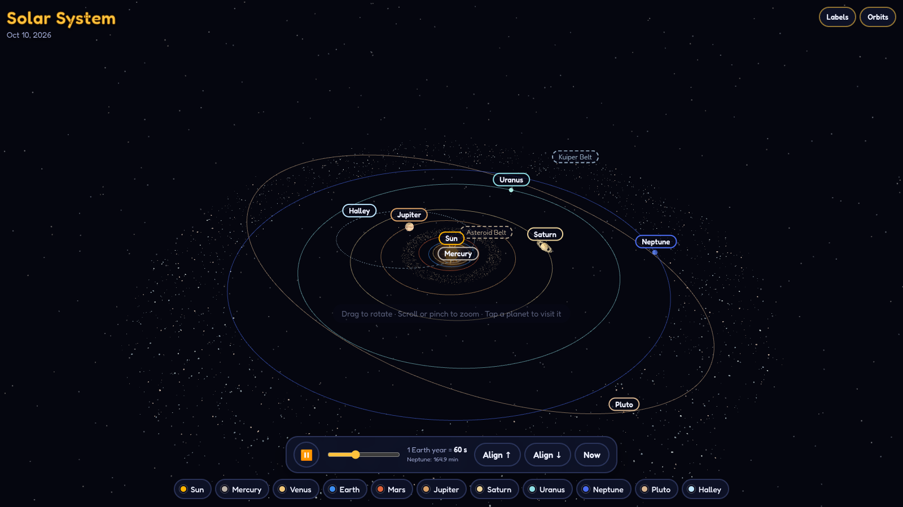
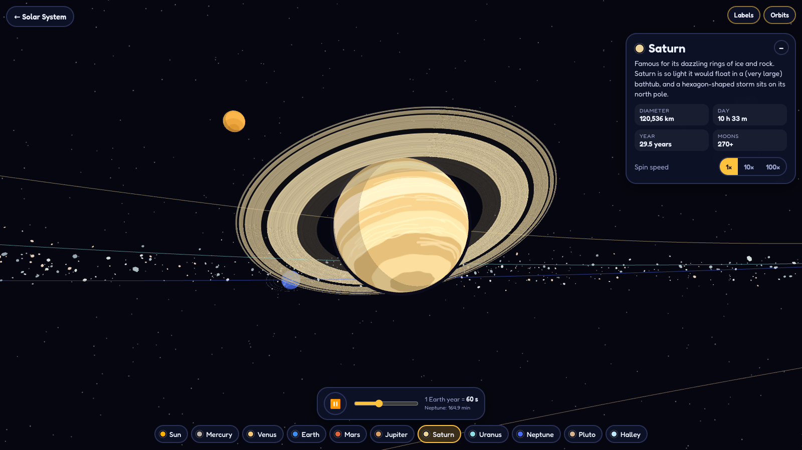

# Cartoon Solar System

An interactive Three.js model of the solar system with cartoon-style planets. It works with a mouse or a touchscreen.





## Features

- **Real orbits.** Each orbit uses JPL's J2000 orbital elements: real eccentricity, inclination and perihelion direction. The positions are solved with Kepler's equation, so planets speed up near the Sun. On load, every body is placed where it actually is today.
- **Relative speeds.** Periods follow Kepler's third law. At 1× speed, Earth takes 60 s per orbit, Mercury about 14 s, and Neptune about 2.7 hours. The slider runs from 0.1× to 50×.
- **Align ↑ / Align ↓** moves every planet (and Pluto) forward along its own orbit until they form a straight line above or below the Sun. **Now** puts them back at today's real positions.
- **Cartoon planets** with their best-known features:
  - Mercury's craters
  - Venus's swirling clouds
  - Earth's continents, clouds and a hurricane, plus the Moon
  - Mars's polar caps, Olympus Mons and Valles Marineris, plus Phobos and Deimos
  - Jupiter's bands and Great Red Spot, plus the Galilean moons
  - Saturn's rings (with the Cassini division), polar hexagon and Titan
  - Uranus tipped on its side with vertical rings
  - Neptune's Great Dark Spot and Triton
  - Pluto's heart, plus Charon
- **Other objects:** the asteroid belt (with Kirkwood gaps), the Kuiper belt, and Halley's Comet on its retrograde orbit, with a tail that grows near the Sun and points away from it.
- **Controls:**
  - Drag to rotate.
  - Use the mouse wheel or a two-finger pinch to zoom.
  - Tap or click a planet, its label or its chip to fly to it and watch it spin (1×, 10× or 100× spin speed).
  - **← Solar System** or `Esc` returns to the overview, and `Space` pauses.

### Scale notes
Real distances are too large to show at once, so semi-major axes are compressed with a power law (`34 · AU^0.65`). Each ellipse still keeps its real eccentricity, so the orbit *shapes* are accurate. Planet sizes are exaggerated. Spin and moon motion run on a separate, slower clock (Earth day = 6 s at 1×), because at orbital speed Earth would spin 365 times a minute.

## Run locally
```bash
npm install
npm run dev        # http://localhost:5173 (also on your LAN for phone testing)
```

## Deploy with Docker
```bash
cp .env.example .env              # then set HOST_PORT to a free port on your server
docker compose up -d --build      # serves on http://<server>:<HOST_PORT>
```
`HOST_PORT` defaults to 8080 if `.env` is missing. The container always listens on 8080 internally.
Or without compose:
```bash
docker build -t cartoon-solar-system .
docker run -d --name solar-system -p 8080:8080 --restart unless-stopped cartoon-solar-system
```
The image uses a multi-stage build: Node builds the static site, and an unprivileged, non-root `nginx-unprivileged:alpine-slim` image serves it (~20 MB). `apk upgrade` runs at build time, so rebuild periodically to pick up security fixes. Asset paths are relative, so the site also works behind a reverse proxy at a sub-path such as `/solar/`. The container has a health endpoint at `/healthz`.
